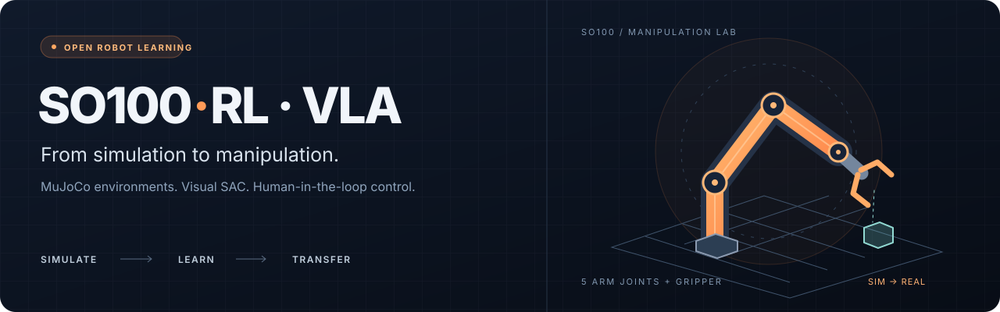
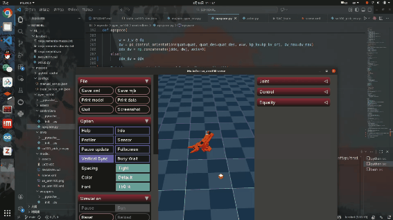
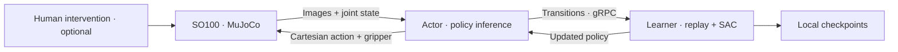

<div align="center">
  
  <br><br>
  <a href="LICENSE"></a>
  
  
  
  <p><b>An open simulation playground for learning to manipulate with the SO100.</b></p>
  <p><a href="#demos">Demos</a> · <a href="#quick-start">Quick start</a> · <a href="docs/reproducibility.md">Reproduction guide</a> · <a href="README.zh-CN.md">简体中文</a></p>
</div>

Train visual manipulation policies in MuJoCo, collect human demonstrations, and explore transfer to a real SO100 arm. The project adapts components from [LeRobot](https://github.com/huggingface/lerobot) and provides its own SO100 pick-and-lift environment and SAC actor–learner pipeline.

## Demos

<table>
  <tr>
    <th align="center">01 · Simulation</th>
    <th align="center">02 · Real robot</th>
    <th align="center">03 · Generalization</th>
  </tr>
  <tr>
    <td width="33%"></td>
    <td width="33%"></td>
    <td width="33%"></td>
  </tr>
  <tr>
    <td align="center">Learn in a controllable environment</td>
    <td align="center">Explore simulation-to-real transfer</td>
    <td align="center">Test beyond the training setup</td>
  </tr>
</table>

<details>
<summary>Reproduction scope &amp; available artifacts</summary>

**Reproduction scope:** the supported starting point is **SO100 simulation + visual SAC**. The demos below are author-provided experiments. Pretrained weights, the original demonstration dataset, and a complete real-robot deployment recipe are not included. A passing smoke test checks the software pipeline; reproducing the demonstrated task success requires training and evaluation.

</details>

## What is inside

| Component | What you can work with |
| :--- | :--- |
| **SO100 simulation** | MuJoCo model, Cartesian control, cube lifting, sparse/dense reward, front and wrist cameras |
| **Visual SAC** | Separate actor and learner, gRPC transport, replay buffers, local checkpoints |
| **Human demonstrations** | Keyboard interaction, local recording and replay through the manipulator entry point |
| **Robot integration** | SO100 follower/leader and camera components; hardware-specific setup is required |
| **Policy research** | ACT, Diffusion, π₀, π₀.₅ and GR00T source modules; these backends are outside the tested SAC baseline |



## Quick start

**Baseline:** Linux x86_64, Python **3.10**, PyTorch **2.7.1** / torchvision **0.22.1**, MuJoCo **3.4.0**. A CPU is enough for the smoke test. Use an NVIDIA GPU for longer training. Run the following commands from the repository root.

### 1. Create the environment

```bash
git clone https://github.com/NOOBHZ233/SO100-RL-VLA.git
cd SO100-RL-VLA
conda env create -f environment.yml
conda activate so100-rl-vla
```

On Ubuntu/Debian, install the rendering libraries once:

```bash
sudo apt-get update
sudo apt-get install -y libgl1 libegl1 libosmesa6
```

### 2. Install PyTorch and the project

Choose **one** PyTorch command ([official wheel matrix](https://pytorch.org/get-started/previous-versions/#v2-7-1)):

```bash
# CPU: recommended for the first installation check
python -m pip install torch==2.7.1 torchvision==0.22.1 --index-url https://download.pytorch.org/whl/cpu

# NVIDIA GPU: use this instead of the CPU command
# python -m pip install torch==2.7.1 torchvision==0.22.1 --index-url https://download.pytorch.org/whl/cu126

python -m pip install -c requirements/constraints-py310.txt -e ".[keyboard,dev]"
python -m pip check
```

The constraints pin the Python dependencies used by the simulation checks. CUDA runtime packages depend on the selected wheel; see [environment details](docs/reproducibility.md#environment).

### 3. Verify the full local pipeline

```bash
MUJOCO_GL=osmesa HF_HUB_OFFLINE=1 python -m project.rl.smoke
MUJOCO_GL=osmesa HF_HUB_OFFLINE=1 python -m pytest
```

The smoke test renders both cameras, runs policy inference, samples replay data, performs SAC gradient updates, and saves/reloads a checkpoint. It finishes with `"status": "ok"`. It needs no robot, credentials, dataset download, or pretrained model.

### 4. Start training

Launch the learner first, then the actor in a second terminal with the same environment activated:

```bash
# Terminal 1 · learner
python -m project.rl.learner --config_path config/train_so100_sim.json
```

```bash
# Terminal 2 · actor (offscreen rendering on NVIDIA)
MUJOCO_GL=egl python -m project.rl.actor --config_path config/train_so100_sim.json
```

The training config selects `cuda`. For a CPU run, add `--policy.device=cpu --policy.storage_device=cpu` to **both** commands and use `MUJOCO_GL=osmesa` for the actor. The default runs online SAC with a local CNN, a continuous four-dimensional action, and local logging. Keyboard demonstrations and a pretrained visual encoder can be added as separate experiments. See [training and recording](docs/reproducibility.md#training-and-recording) for commands, expected outputs, and memory settings.

### 5. Try keyboard control

Use an X11 desktop session with a display and install the `keyboard` extra above:

```bash
python -m project.rl.gym_manipulator --config_path config/manual_so100.json
```

Arrow keys move in XY; left/right Shift moves down/up; left/right Ctrl closes/opens the gripper; Enter marks success and Esc ends a failed episode. See the [recording guide](docs/reproducibility.md#training-and-recording) to save your own demonstrations.

## Project map

```text
config/                         Training and manual-control examples
src/project/rl/gym_so100/        Environment, control, wrappers, MJCF and meshes
src/project/rl/                  Actor, learner, replay and smoke check
src/project/policies/            SAC and additional policy modules
src/project/robots/              SO100 robot interfaces
src/project/processor/           Observation and action processing
requirements/                   Pinned baseline dependencies
tests/                          Offline integration and regression checks
```

To change the task, start with [`so100_pick_env.py`](src/project/rl/gym_so100/envs/so100_pick_env.py); to change the scene, edit [`scene.xml`](src/project/rl/gym_so100/model/scene.xml). Read [troubleshooting and limitations](docs/reproducibility.md#troubleshooting) before configuring other backends or hardware.

## Acknowledgements & contact

Built on work from [Hugging Face LeRobot](https://github.com/huggingface/lerobot), [MuJoCo](https://github.com/google-deepmind/mujoco), and [The Robot Studio SO-ARM100](https://github.com/TheRobotStudio/SO-ARM100). Upstream copyright notices and the [robot model license](src/project/rl/gym_so100/model/LICENSE) are retained.

**Chengwei Zhang** · [Email](mailto:ZhangCW233666@163.com) · QQ: 2017809834<br>
Questions or reproduction reports: [open an issue](https://github.com/NOOBHZ233/SO100-RL-VLA/issues) with your OS, Python/PyTorch versions, configuration, and full error output.

Licensed under [Apache 2.0](LICENSE). The open-source SO100 platform is used to share the simulation work while respecting confidentiality constraints on the original system.
