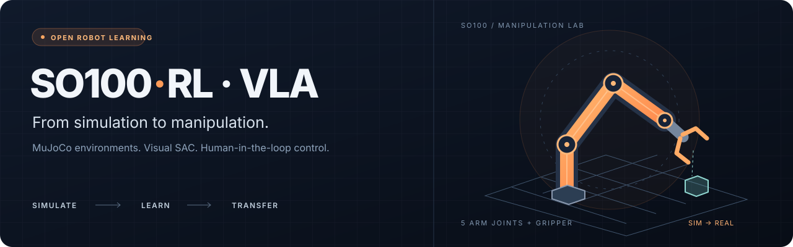
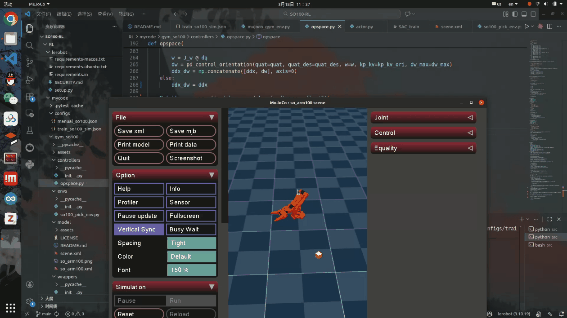
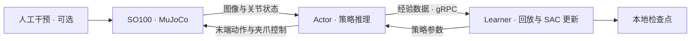

<div align="center">
  
  <br><br>
  <a href="LICENSE"></a>
  
  
  
  <p><b>面向 SO100 机械臂的开源仿真与机器人学习实验平台。</b></p>
  <p><a href="#效果演示">效果演示</a> · <a href="#快速开始">快速开始</a> · <a href="docs/reproducibility.md">复现与排错</a> · <a href="README.md">English</a></p>
</div>

在 MuJoCo 中训练视觉操作策略、采集人工示范，并探索向真实 SO100 机械臂迁移。本项目基于 [LeRobot](https://github.com/huggingface/lerobot) 的部分组件，提供 SO100 抓取抬升任务、SAC Actor–Learner 训练流程与机器人接口。

## 效果演示

<table>
  <tr><th>01 · 仿真训练</th><th>02 · 实机测试</th><th>03 · 泛化测试</th></tr>
  <tr>
    <td width="33%"></td>
    <td width="33%"></td>
    <td width="33%"></td>
  </tr>
</table>

<details>
<summary>复现范围与实验材料</summary>

**复现范围：** 当前验证入口是 **SO100 仿真 + 视觉 SAC**。下面的动图展示作者已有的实验；仓库尚未提供这些实验对应的预训练权重、原始示范数据及完整实机部署配置。通过冒烟检查代表软件流程可以运行；复现动图中的任务成功效果仍需要训练与评估。

</details>

## 项目提供什么

| 模块 | 内容 |
| :--- | :--- |
| **SO100 仿真** | MuJoCo 模型、末端笛卡尔控制、方块抬升、稀疏/稠密奖励、前置与腕部相机 |
| **视觉 SAC** | 独立 Actor 与 Learner、gRPC 通信、回放缓冲区、本地检查点 |
| **人工示范** | 键盘交互、本地录制与回放 |
| **硬件组件** | SO100 主从臂、串口与相机接口；需要针对实际硬件配置 |
| **策略研究代码** | ACT、Diffusion、π₀、π₀.₅、GR00T 源码；不属于已验证的 SAC 基线 |



## 快速开始

基线环境：**Linux x86_64 + Python 3.10 + PyTorch 2.7.1 + torchvision 0.22.1 + MuJoCo 3.4.0**。CPU 可以完成安装与冒烟检查，较长训练建议使用 NVIDIA GPU。以下命令均在仓库根目录运行。

### 1. 创建环境

```bash
git clone https://github.com/NOOBHZ233/SO100-RL-VLA.git
cd SO100-RL-VLA
conda env create -f environment.yml
conda activate so100-rl-vla
```

Ubuntu/Debian 需要安装渲染动态库：

```bash
sudo apt-get update
sudo apt-get install -y libgl1 libegl1 libosmesa6
```

### 2. 安装依赖

先选择一种 PyTorch 安装方式，再安装项目：

```bash
# CPU：首次验证推荐使用
python -m pip install torch==2.7.1 torchvision==0.22.1 --index-url https://download.pytorch.org/whl/cpu

# NVIDIA GPU：用此命令替代上面的 CPU 命令
# python -m pip install torch==2.7.1 torchvision==0.22.1 --index-url https://download.pytorch.org/whl/cu126

python -m pip install -c requirements/constraints-py310.txt -e ".[keyboard,dev]"
python -m pip check
```

Python 依赖由 constraints 文件固定。CUDA 运行库随所选 PyTorch wheel 安装；详见[环境说明](docs/reproducibility.md#environment)与 [PyTorch 官方安装矩阵](https://pytorch.org/get-started/previous-versions/#v2-7-1)。

### 3. 检查本地完整流程

```bash
MUJOCO_GL=osmesa HF_HUB_OFFLINE=1 python -m project.rl.smoke
MUJOCO_GL=osmesa HF_HUB_OFFLINE=1 python -m pytest
```

检查内容包括：双相机渲染、策略推理、经验采样、SAC 梯度更新、检查点保存与重载、Protobuf 序列化。输出包含 `"status": "ok"` 即为通过。无需连接机械臂、登录账号或下载模型与数据。

### 4. 启动 SAC 训练

先启动 Learner，然后在第二个终端激活同一环境并启动 Actor：

```bash
# 终端 1
python -m project.rl.learner --config_path config/train_so100_sim.json
```

```bash
# 终端 2：NVIDIA 离屏渲染
MUJOCO_GL=egl python -m project.rl.actor --config_path config/train_so100_sim.json
```

配置默认使用 `cuda`。CPU 运行时，在两个命令后都添加 `--policy.device=cpu --policy.storage_device=cpu`，并将 Actor 的 `MUJOCO_GL` 改为 `osmesa`。

默认配置采用本地 CNN、四维连续动作、纯在线采样，并关闭 W&B 与 Hub 上传。它提供一个无需外部模型与数据的训练入口。输出位置、内存配置、人工示范与实验扩展见[复现指南](docs/reproducibility.md#training-and-recording)。

### 5. 使用键盘操作仿真机械臂

需要带显示器的 X11 桌面会话，以及前面安装的 `keyboard` extra：

```bash
python -m project.rl.gym_manipulator --config_path config/manual_so100.json
```

| 按键 | 动作 |
| :--- | :--- |
| 方向键 | XY 平面移动 |
| 左 / 右 Shift | 向下 / 向上移动 |
| 左 / 右 Ctrl | 闭合 / 打开夹爪 |
| Enter / Esc | 标记成功 / 结束失败回合 |
| R | 请求重新录制当前回合 |

手柄驱动尚未包含在开源仓库中。录制自己的示范请使用[本地录制流程](docs/reproducibility.md#training-and-recording)。

## 代码导航

| 路径 | 用途 |
| :--- | :--- |
| [`config/`](config/) | 训练与键盘操作配置 |
| [`src/project/rl/gym_so100/`](src/project/rl/gym_so100/) | 仿真环境、控制器、包装器、MJCF 与网格 |
| [`src/project/rl/`](src/project/rl/) | Actor、Learner、回放与冒烟检查 |
| [`src/project/policies/`](src/project/policies/) | SAC 与其他策略源码 |
| [`src/project/robots/`](src/project/robots/) | SO100 机器人接口 |
| [`requirements/`](requirements/) | 固定版本的依赖约束 |
| [`tests/`](tests/) | 离线集成与回归检查 |

修改任务逻辑从 [`so100_pick_env.py`](src/project/rl/gym_so100/envs/so100_pick_env.py) 开始，修改场景从 [`scene.xml`](src/project/rl/gym_so100/model/scene.xml) 开始。实机与其他模型的支持边界见[限制与排错](docs/reproducibility.md#troubleshooting)。

## 致谢与联系

感谢 [Hugging Face LeRobot](https://github.com/huggingface/lerobot)、[MuJoCo](https://github.com/google-deepmind/mujoco) 和 [The Robot Studio SO-ARM100](https://github.com/TheRobotStudio/SO-ARM100)。项目保留上游版权声明与[机械臂模型协议](src/project/rl/gym_so100/model/LICENSE)。

**Chengwei Zhang** · [邮箱](mailto:ZhangCW233666@163.com) · QQ：2017809834<br>
复现问题请[提交 Issue](https://github.com/NOOBHZ233/SO100-RL-VLA/issues)，附系统、Python/PyTorch 版本、配置和完整报错。

项目采用 [Apache 2.0](LICENSE) 协议。基于保密要求，使用开源 SO100 机械臂分享仿真环境与相关实验。
